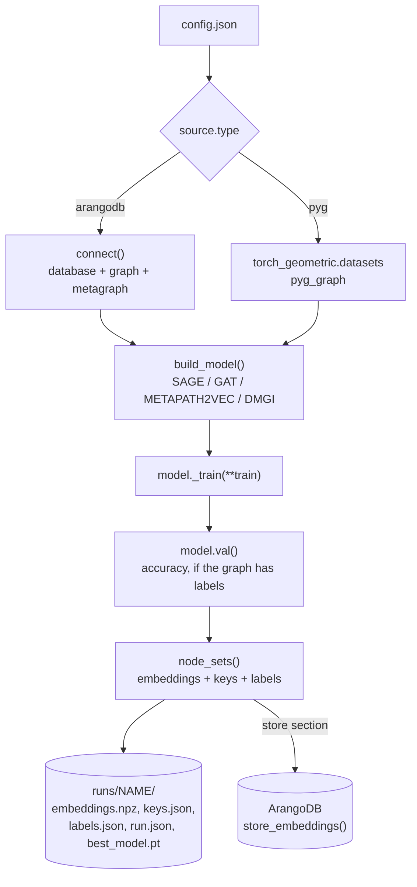

# 01 - Embedding pipeline CLI

`fgml.py` wraps fastgraphml in a command line tool. An embedding job is described
once, in a JSON file, and can then be run, re-run and scheduled without touching
Python.

## Use case

A team keeps several graphs in ArangoDB: products, customers, documents. Each of them
needs fresh embeddings every night, because the similarity search and the
recommendations of other services read them. Nobody wants a notebook per graph. What
is needed is:

* a way to look at a graph and find out what can be fed to a model,
* one file per job that says which graph, which model, which settings and where the
  result goes,
* one command that does the whole job and leaves both files and database documents
  behind,
* a quick way to judge the result without writing code.

That is what the six commands do.

| Command | Purpose |
| ------- | ------- |
| `check` | Installed versions, optional packages, database connection |
| `inspect` | Graphs, collections and attributes of the database, plus a proposed metagraph |
| `load-demo` | Loads a demo dataset (default: Amazon Computer Products) |
| `run CONFIG` | Train, evaluate, save a run folder, store the embeddings in ArangoDB |
| `similar RUN KEY` | Nearest neighbours of a node, from the run folder or from ArangoDB (`--db`) |
| `export RUN` | Embeddings as CSV or JSON lines for other tools |

## Quick start without a database

```bash
cd examples/01-embedding-cli
python fgml.py run configs/cora_offline.json      # about 10 seconds on a laptop CPU
python fgml.py similar runs/cora 42 -k 5
python fgml.py export runs/cora --format csv
```

Output of the second command (from an actual run, three epochs):

```
    Most similar to nodes/42 (Rule Learning)
┏━━━┳━━━━━━┳━━━━━━━━━━━━━━━━━━━┳━━━━━━━━━━━━━━━┓
┃ # ┃ key  ┃ cosine similarity ┃ class         ┃
┡━━━╇━━━━━━╇━━━━━━━━━━━━━━━━━━━╇━━━━━━━━━━━━━━━┩
│ 1 │ 1372 │            0.9457 │ Rule Learning │
│ 2 │ 447  │            0.9389 │ Rule Learning │
│ 3 │ 56   │            0.9362 │ Rule Learning │
│ 4 │ 87   │            0.9334 │ Rule Learning │
│ 5 │ 1362 │            0.9286 │ Rule Learning │
└───┴──────┴───────────────────┴───────────────┘
```

## With ArangoDB

Set up the database and `examples/.env` as described in the
[examples README](../README.md), then:

```bash
python fgml.py check                              # is everything in place?
python fgml.py load-demo                          # Amazon Computer Products
python fgml.py inspect                            # what did that create?
python fgml.py run configs/amazon_arangodb.json
python fgml.py similar runs/amazon <product key> --db
```

`inspect` reads one document per vertex collection and guesses which attributes can
be used: a list of numbers can be the node features (`x`), an integer can be the
label (`y`). It prints a metagraph to copy into a config and correct.

## The config file

```json
{
  "name": "amazon",
  "source": {
    "type": "arangodb",
    "graph": "product_graph",
    "metagraph": {
      "vertexCollections": { "Computer_Products": { "x": "features", "y": "label" } },
      "edgeCollections": { "bought_together": {} }
    }
  },
  "model": {
    "name": "SAGE",
    "params": { "embedding_size": 64, "sizes": [10, 10], "batch_size": 512,
                "transform": ["NormalizeFeatures"] }
  },
  "train": { "epochs": 10, "lr": 0.005 },
  "store": { "collection": "cli_product_embeddings", "nearest_neighbors": 10,
             "class_names": { "0": "Desktops", "1": "Data Storage" } }
}
```

| Section | Meaning |
| ------- | ------- |
| `source` | `"type": "arangodb"` with `graph` and `metagraph`, or `"type": "pyg"` with the name of a `torch_geometric.datasets` class and its arguments |
| `model.name` | `SAGE`, `GAT`, `METAPATH2VEC` or `DMGI` |
| `model.params` | Passed to the model class. `transform` is a list of `torch_geometric.transforms` class names; `metapaths` are written as JSON lists and converted to tuples |
| `train` | Passed to `model._train()`: `epochs`, `lr`, optimizer arguments |
| `store` | Optional. `collection` for `store_embeddings`, `nearest_neighbors` to also store the top-k neighbours of every node, `node_type` for heterogeneous models, `class_names` for readable labels |

The four configs in `configs/` cover a homogeneous and a heterogeneous graph, each
online and offline.

## How it works



The fastgraphml part of `fgml.py` is short. Building the model:

```python
def build_model(config):
    name = config["model"]["name"].upper()
    params = dict(config["model"].get("params", {}))
    ...
    return getattr(fastgraphml, name)(**model_inputs(config["source"]), **params)
```

`model_inputs` returns either `database`, `arango_graph` and `metagraph`, or
`pyg_graph`: the two ways every fastgraphml model can be given a graph. Training and
evaluating:

```python
model._train(ckp_path=None, best_model_path=str(run_dir / "best_model.pt"), **train)
if model.has_labels:
    val_acc, test_acc = model.val()
```

`node_sets` hides the one difference between the model families: `SAGE` and `GAT`
return one array, `METAPATH2VEC` and `DMGI` a dictionary with one array per node
type. It also picks the right keys: `model.graph_util.node_keys` holds the ArangoDB
`_key` of every node when the graph came from ArangoDB.

Storing uses fastgraphml's own method, so the documents have the layout described in
the [examples README](../README.md#what-an-embedding-document-looks-like):

```python
model.graph_util.store_embeddings(
    emb, collection_name=store["collection"], class_mapping=class_names,
    node_type=node_type, nearest_nbors_search=neighbors > 0, top_k_nbors=neighbors,
)
```

## Run folder

```
runs/cora/
├── run.json          config, metrics, node sets
├── embeddings.npz    one array per node set
├── keys.json         node keys, in the order of the embedding rows
├── labels.json       labels, if the graph has them
└── best_model.pt     best checkpoint (highest validation accuracy, or lowest loss)
```

## Limits

* `similar --db` compares against every stored embedding in AQL. For large
  collections use the `nearest_neighbors` option, which precomputes the neighbours
  with FAISS at store time, or an ArangoDB vector index.
* A `run` trains from scratch every time; resuming from a checkpoint is not
  implemented.
* The ArangoDB commands (`check`, `inspect`, `load-demo`, `run` with an `arangodb`
  source, `similar --db`) have not been run against a server yet.
