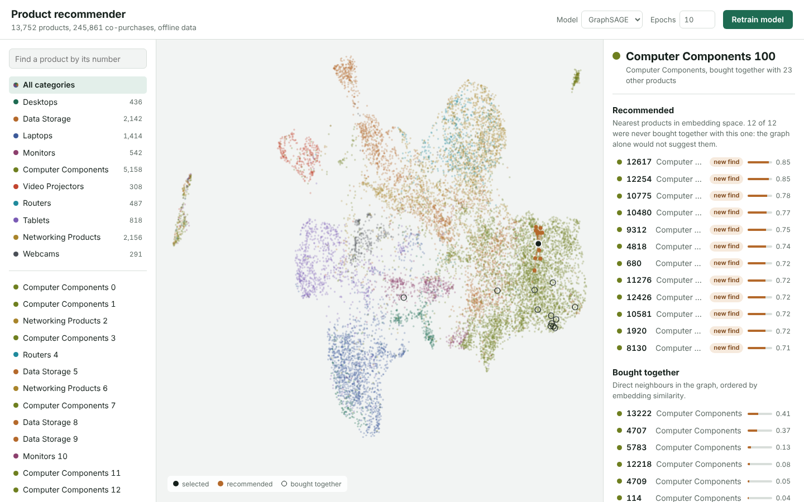
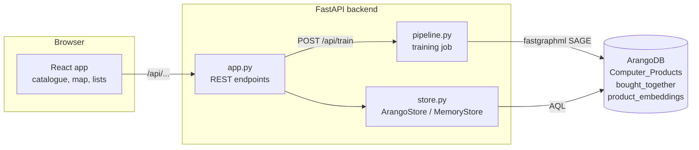

# 02 - Product recommender

A web app that recommends products from a co-purchase graph. Pick a product and see
two answers side by side: what the graph says directly ("bought together") and what
the embeddings add ("recommended").



## Use case

An online shop for computer hardware knows which products end up in the same basket.
That is a graph: 13,752 products, 245,861 "bought together" edges, and a category for
every product (the Amazon Computers dataset used in the fastgraphml article).

The direct edges already give a recommendation list, but only for products with
enough sales, and only products that were literally bought with this one. A product
that is bought in the *same kind of company* never shows up. Graph embeddings close
that gap: GraphSAGE gives every product a vector that summarises its neighbourhood,
and products with similar neighbourhoods get similar vectors, connected or not.

The app makes that visible:

* **Recommended**: the nearest products in embedding space. Each one that has no
  direct edge to the selected product is tagged "new find".
* **Bought together**: the direct neighbours, ordered by embedding similarity.
* **Map**: all products laid out by their embeddings and coloured by category.
  Categories form regions although the model never saw the category labels.

## Run it

```bash
cd examples/02-product-recommender

# backend, offline mode: downloads the dataset on first training
FGML_MODE=offline uvicorn backend.app:app --port 8000

# frontend, second terminal
cd frontend && npm install && npm run dev      # http://localhost:5173
```

Press **Train model**. Ten epochs take about one and a half minutes on a laptop CPU;
the map and the recommendations appear when it finishes.

With ArangoDB (after the setup in the [examples README](../README.md)):

```bash
python -m backend.load_data                  # once: loads the product graph
uvicorn backend.app:app --port 8000          # FGML_MODE defaults to arangodb
```

For a single process, build the frontend (`npm run build`); the backend then serves
it at <http://localhost:8000>. `/?product=<key>` opens a product directly, and
<http://localhost:8000/docs> lists the API.

## Architecture



| File | Role |
| ---- | ---- |
| `backend/config.py` | Names of graph and collections, the metagraph, `.env` loading |
| `backend/pipeline.py` | The training job, the only file that uses fastgraphml |
| `backend/store.py` | All reads: AQL in `ArangoStore`, numpy in `MemoryStore` |
| `backend/app.py` | REST API and static files |
| `backend/load_data.py` | Loads the demo graph into ArangoDB |
| `frontend/src/App.tsx` | The page: catalogue, training control, result lists |
| `frontend/src/EmbeddingMap.tsx` | Canvas scatter plot of all products |

Training and serving are separate on purpose. Training writes embeddings to the
database; the API only reads. After a restart the app works without retraining, and
the job could just as well run from a scheduler (see
[01-embedding-cli](../01-embedding-cli/README.md)).

## The training job

`backend/pipeline.py`, shortened:

```python
import torch_geometric.transforms as T
from fastgraphml import SAGE

METAGRAPH = {
    "vertexCollections": {"Computer_Products": {"x": "features", "y": "label"}},
    "edgeCollections": {"bought_together": {}},
}

# 1. ArangoDB graph + metagraph -> model
model = SAGE(db, "product_graph", METAGRAPH, embedding_size=64, sizes=[10, 10],
             batch_size=512, transform=T.NormalizeFeatures())

# 2. unsupervised training: connected products should get similar vectors
model._train(epochs=10, lr=0.005, ckp_path=None, best_model_path=None)

# 3. embeddings and a quality check
emb = model.get_embeddings()            # numpy array, 13,752 x 64
val_acc, test_acc = model.val()         # can a linear model predict the category?
emb = whiten(emb)                       # see "What we learned" below

# 4. back to ArangoDB, one document per product
model.graph_util.store_embeddings(emb, collection_name="product_embeddings",
                                  class_mapping=CATEGORIES)
```

Three details worth knowing:

* **The metagraph** maps ArangoDB attributes to what the model expects: the
  `features` attribute (a list of 767 numbers) becomes `x`, `label` becomes `y`.
  Labels are only used to measure quality, not for training.
* **Progress**: fastgraphml prints one line per epoch. `EpochWatcher` stands in for
  `sys.stdout` during training and picks the epoch number out of those lines, which
  is how the progress bar knows where the job is.
* **`model.val()`** trains a logistic regression on the embeddings of the training
  nodes and reports its accuracy on held-out nodes. About 70% after ten epochs on
  ten categories; more epochs help.

## The queries

Recommendations, `ArangoStore.similar`:

```aql
LET q = DOCUMENT(CONCAT(@emb, "/", @key)).embedding
LET neighbours = (FOR v IN 1..1 ANY @start @@edges RETURN DISTINCT v._key)
FOR e IN @@emb
    FILTER e._key != @key
    LET score = COSINE_SIMILARITY(e.embedding, q)
    SORT score DESC
    LIMIT @k
    RETURN { key: e._key, label: e.label, score: score,
             bought_together: e._key IN neighbours }
```

One query does both things the UI needs: rank all products by similarity, and mark
the ones that are also direct neighbours. It works because the embedding documents
have the same `_key` as the products.

Bought together, `ArangoStore.bought_together`, is a one-step traversal that looks
up the embedding of each neighbour to order them.

`MemoryStore` answers the same questions with a matrix product, which is what the
offline mode uses.

## API

| Endpoint | Returns |
| -------- | ------- |
| `GET /api/status` | mode, counts, whether graph and embeddings exist, state of the training job |
| `POST /api/train` | starts a training: `{"model": "SAGE", "epochs": 10, "embedding_size": 64}` |
| `GET /api/categories` | categories with product counts |
| `GET /api/products?category=&q=&limit=&offset=` | catalogue page |
| `GET /api/products/{key}` | one product with its number of co-purchases |
| `GET /api/products/{key}/similar?k=` | recommendations |
| `GET /api/products/{key}/bought-together?limit=` | direct neighbours |
| `GET /api/map` | 2D position and category of every product |

## What we learned

* **Normalise the features.** The features are word counts. Without
  `T.NormalizeFeatures()` and with a learning rate of 0.005 the training diverged
  (accuracy 3%); with it, 68% after ten epochs.
* **Raw embeddings were nearly one-dimensional.** After ten epochs 93% of the
  variance sat in a single direction, so every cosine similarity among the nearest
  neighbours was above 0.99 and the ranking carried little information. `whiten()`
  applies PCA whitening and keeps 32 dimensions; on a sample, the share of the 12
  nearest neighbours in the same category rose from 72% to 76%, and the scores
  spread out between 0.5 and 0.9.
* **Direct neighbours are often not the nearest vectors.** In the screenshot none of
  the twelve recommendations was bought together with the selected product, and its
  direct neighbours have low similarity. A production recommender would blend both
  signals; the app shows them separately so that the difference can be seen.

## Limits

* The dataset has no product titles, so products are shown as category plus number.
* One training at a time, started from the UI, no authentication: a demo, not a
  service.
* The similarity query scans the whole embedding collection. See the note on vector
  indexes in the [examples README](../README.md).
* The ArangoDB mode has not been run against a server yet.
