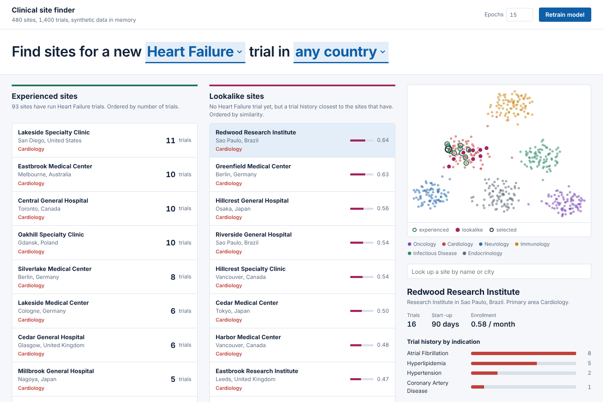
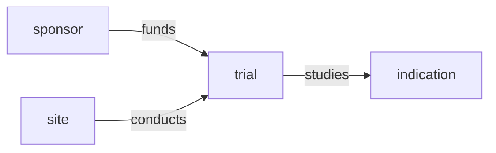
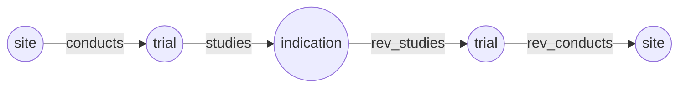
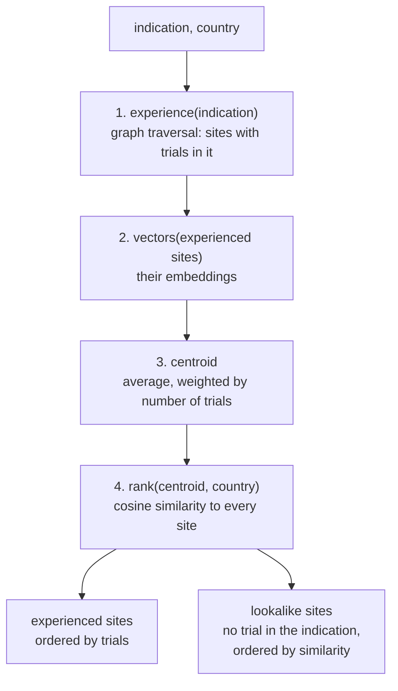

# 03 - Clinical site finder

A web app for one question from clinical trial planning: *which sites should we ask
to run a new trial in this indication?* It answers with two lists: the sites that
have done it before, and the sites that have not but look just like them.



All data in this example is synthetic. Sites, sponsors and trials are generated from
a fixed random seed (`backend/data.py`); no name refers to a real organisation.

## Use case

Feasibility teams pick investigator sites for a new trial. The obvious candidates
are the sites that already ran trials in the same indication, and a database query
finds them. The same sites get asked every time, though, and they are busy.

The interesting candidates are sites with **no** trial in the indication whose trial
history is otherwise close to the experienced sites: same therapeutic area, similar
indications, the same kind of sponsors. A query on past experience cannot find them,
because the thing being asked for is exactly what is missing. A similarity search on
graph embeddings can.

The graph is heterogeneous: different kinds of nodes and edges.



| Collection | Documents | Attributes |
| ---------- | --------- | ---------- |
| `site` | 480 | name, city, country, kind, primary area, capacity, start-up days, enrollment rate |
| `trial` | 1,400 | title, phase, year |
| `indication` | 30 | name, therapeutic area (6 areas, 5 indications each) |
| `sponsor` | 30 | name |
| `conducts` | 8,361 | site → trial, patients enrolled |
| `studies`, `funds` | 1,400 each | trial → indication, sponsor → trial |

## Run it

```bash
cd examples/03-clinical-site-finder

# backend, offline mode: the generated data stays in memory
FGML_MODE=offline uvicorn backend.app:app --port 8001

# frontend, second terminal
cd frontend && npm install && npm run dev      # http://localhost:5174
```

Press **Train model** (about half a minute), then change the indication or the
country in the sentence at the top. Click a site for its trial history.

With ArangoDB (after the setup in the [examples README](../README.md)):

```bash
python -m backend.load_data                  # once: writes the graph to the database
uvicorn backend.app:app --port 8001
```

After `npm run build` the backend serves the app itself at <http://localhost:8001>.
The address bar keeps the current question, e.g. `/?indication=I06&country=Germany`,
so a result can be shared as a link.

## How the embeddings are made

Sites have almost no features of their own, and the information that matters is two
steps away: a site is connected to trials, and trials to indications. METAPATH2VEC
is made for this. It walks the graph along a fixed pattern of node types, the
metapath, and learns vectors such that nodes which appear close together on these
walks get similar vectors.



Two sites end up on the same walk when they run trials in the same indication. Sites
that share many indications share many walks, and get similar embeddings.

`backend/pipeline.py`, shortened:

```python
import torch_geometric.transforms as T
from fastgraphml import METAPATH2VEC

METAGRAPH = {
    "vertexCollections": {
        "site": {"x": "features", "y": "area"},   # y: primary therapeutic area
        "trial": {},
        "indication": {},
    },
    "edgeCollections": {"conducts": {}, "studies": {}},
}
METAPATH = [
    ("site", "conducts", "trial"),
    ("trial", "studies", "indication"),
    ("indication", "rev_studies", "trial"),
    ("trial", "rev_conducts", "site"),
]

model = METAPATH2VEC(
    db, "clinical_trials", METAGRAPH,
    metapaths=METAPATH, key_node="site",
    embedding_size=64, walk_length=20, context_size=7, walks_per_node=10,
    num_negative_samples=5, sparse=True,
    transform=T.ToUndirected(),          # adds the rev_ edge types
    num_nodes_dict=counts,               # number of documents per collection
)
model._train(epochs=15, lr=0.03, ckp_path=None, best_model_path=None)

emb = model.get_embeddings()["site"]     # one array per node type of the metapath
model.graph_util.store_embeddings(emb, collection_name="site_embeddings",
                                  node_type="site", class_mapping=AREAS)
```

Points to note:

* **The metagraph selects a subgraph.** Sponsors are in the database and in the UI,
  but not in the metagraph, so the model never sees them.
* **`T.ToUndirected()`** is passed as `transform`. Edges in ArangoDB have one
  direction; the walk has to come back from the indication, so the transform adds a
  reversed copy of every edge type, named `rev_<edge collection>`.
* **`key_node="site"`** names the node type whose labels are used to validate. The
  label is the site's primary therapeutic area. A logistic regression on the
  embeddings predicts it with 96 to 98% accuracy on held-out sites, although the
  model was never given the areas: the six clusters on the map come from the walks
  alone.
* **Labels are optional.** Without `y` the validation is skipped and training works
  the same.

## How a question is answered

`GET /api/recommend?indication=I06&country=Germany`, in `backend/app.py`:



Step 1 is a traversal against the direction of the edges, `ArangoStore.experience`:

```aql
FOR t IN 1..1 INBOUND @indication @@studies
    FOR s IN 1..1 INBOUND t @@conducts
        COLLECT site = s._key WITH COUNT INTO n
        RETURN [site, n]
```

Step 3 is three lines of numpy: the embeddings of the experienced sites are
normalised, weighted by their number of trials and summed into one vector that
stands for "a site that runs this kind of trial".

Step 4 ranks every site against that vector, `ArangoStore.rank`:

```aql
FOR e IN @@emb
    LET s = DOCUMENT(CONCAT(@sites, "/", e._key))
    FILTER s != null
    FILTER @country == null OR s.country == @country
    LET score = COSINE_SIMILARITY(e.embedding, @vector)
    SORT score DESC
    LIMIT @limit
    RETURN { site: s, score: score }
```

The API then splits the ranking by whether a site appears in the result of step 1.
The site card on the right uses one more traversal, `ArangoStore.site`, which
collects the trials of a site with the indication and sponsor of each.

## Does it work?

On the synthetic data the truth is known: the generator gives every site two or
three indications it is specialised in. For Heart Failure, all ten lookalikes in the
screenshot are cardiology sites without a single Heart Failure trial, and their
histories are full of the neighbouring cardiology indications. Across all 30
indications, at least nine of the ten lookalikes belong to the therapeutic area of
the indication in 24 cases; the weakest case is five of ten. The offline tests
(`tests/test_offline.py`) check the split and the country filter.

On real data the same check needs a holdout: hide the trials of some sites in an
indication, train, and see how high those sites rank among the lookalikes.

## Files

| File | Role |
| ---- | ---- |
| `backend/data.py` | The generator, and `to_pyg` for the offline mode |
| `backend/load_data.py` | Writes collections and the `clinical_trials` graph to ArangoDB |
| `backend/config.py` | Collection names, metagraph, metapath |
| `backend/pipeline.py` | The training job, the only file that uses fastgraphml |
| `backend/store.py` | All reads: AQL in `ArangoStore`, dictionaries and numpy in `MemoryStore` |
| `backend/app.py` | REST API, including the recommendation logic |
| `frontend/src/App.tsx` | The page: question, two result lists, site card |
| `frontend/src/SiteMap.tsx` | SVG map of all sites |

## API

| Endpoint | Returns |
| -------- | ------- |
| `GET /api/status` | mode, counts, whether graph and embeddings exist, state of the training job |
| `POST /api/train` | starts a training: `{"epochs": 15, "embedding_size": 64}` |
| `GET /api/facets` | indications and countries for the question |
| `GET /api/recommend?indication=&country=&k=` | experienced and lookalike sites |
| `GET /api/sites?q=&country=&limit=` | site lookup by name or city |
| `GET /api/sites/{key}` | site with trial history, sponsors, recent trials |
| `GET /api/sites/{key}/similar?k=` | sites with the most similar embedding |
| `GET /api/map` | 2D position and area of every site |

## Limits

* The ranking uses trial history only. Capacity, start-up time and enrollment rate
  are shown but not used; a real tool would filter or re-rank on them.
* The centroid is a simple average. For an indication whose experienced sites fall
  into several distinct groups, ranking against each group separately would be
  better.
* One training at a time, no authentication.
* The ArangoDB mode has not been run against a server yet.
