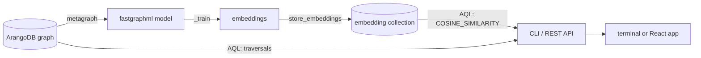

# fastgraphml example projects

Three small projects that use fastgraphml the way an application would: read a graph
from ArangoDB, train an embedding model, write the embeddings back, and answer
questions with them.

| Project | What it shows | Model | Interface |
| ------- | ------------- | ----- | --------- |
| [01-embedding-cli](01-embedding-cli/README.md) | A reusable pipeline: one JSON config per embedding job, for any graph | SAGE, GAT, METAPATH2VEC, DMGI | Command line |
| [02-product-recommender](02-product-recommender/README.md) | "Customers also bought" recommendations on a co-purchase graph | SAGE or GAT | FastAPI + React |
| [03-clinical-site-finder](03-clinical-site-finder/README.md) | Finding trial sites that look like the experienced ones, on a heterogeneous graph | METAPATH2VEC | FastAPI + React |

The two notebooks in this folder (`sage_amazon_computer.ipynb`,
`metapath2vec_dblp.ipynb`) are the original step-by-step walk-throughs.

All three projects follow the same flow:



## The `fex` command

`fex`, in the repository root, prepares the environment and the data, shows what
state everything is in, and runs the examples. It needs nothing but Python 3.10+ to
start with.

```bash
./fex prepare          # virtual environment, packages, examples/.env, web interfaces
./fex link             # optional: put `fex` on your PATH (~/.local/bin or ~/bin)
fex env set ARANGO_PASSWORD=... ARANGO_USER=...      # database settings
fex db init            # optional: create the database and user, asks for the root password
fex db load all        # load the data of all examples
fex status             # environment, settings, database content, running apps
fex run ex2            # start the product recommender at http://localhost:8000
```

| Command | What it does |
| ------- | ------------ |
| `fex prepare` | Creates `.venv`, installs PyTorch, fastgraphml, the ArangoDB adapter and the example packages, creates `examples/.env`, builds both web interfaces. Skips what is already done. Options: `--python`, `--extensions`, `--skip-frontend`, `--rebuild` |
| `fex status` | Installed versions, settings, database connection, documents per collection, running apps |
| `fex env` / `fex env set KEY=VALUE ...` | Shows or changes `examples/.env` (the password is never printed) |
| `fex db` | Collections of the examples and their document counts |
| `fex db init` | Creates the database and user named in `.env`, with access to that database only. Existing ones are left alone |
| `fex db load ex1\|ex2\|ex3\|all` | Loads the product graph (ex1, ex2) and the clinical trial graph (ex3) |
| `fex db clean ex1\|ex2\|ex3\|all` | Drops the collections of an example after confirmation. `--embeddings-only` keeps the data |
| `fex train ex2\|ex3` | Trains and stores embeddings in the terminal, with the full error output. Options: `--epochs`, `--model`, `--offline` |
| `fex run ex1` | Runs the embedding pipeline. With more arguments it runs any `fgml.py` command: `fex run ex1 similar runs/cora 42 -k 5` |
| `fex run ex2\|ex3` | Starts the web app. Options: `--offline`, `--port`, `--open`, `--dev` (Vite dev server with hot reload) |

Everything `fex` does can also be done by hand; the next sections say how.

## Status

Every project has two modes:

* **ArangoDB mode** (default): the graph is read from, and the embeddings are written
  to, the database configured in `examples/.env`.
* **Offline mode**: the graph comes from a PyG dataset or from the generator, and
  everything stays in memory. Nothing but Python is needed.

The offline mode of all three projects has been run end to end. **The ArangoDB mode
was written without access to an ArangoDB server and has not been run yet.** If a
query or a call fails there, please open an issue with the error message.

## Setup

### 1. Python environment

From the repository root, with Python 3.10 or newer:

```bash
python -m venv .venv && source .venv/bin/activate

# PyTorch first, then the PyG extensions built for exactly this PyTorch version
pip install torch
TORCH=$(python -c "import torch; print(torch.__version__.split('+')[0])")
pip install pyg-lib torch-scatter torch-sparse -f https://data.pyg.org/whl/torch-${TORCH}+cpu.html

pip install -e ".[all]"                 # fastgraphml with the arango, search and viz extras
pip install -r examples/requirements.txt
```

If the second `pip install` finds no wheels for your PyTorch version or platform, pip
tries to compile `torch-scatter` and `torch-sparse`, which takes several minutes and
needs a C++ compiler. Two ways around it:

* install a PyTorch version listed on <https://data.pyg.org/whl/>, or
* skip the extensions: `SAGE` and `GAT` then train on the full graph (fine for the
  graphs used here), and the adapter can be installed without them, because it only
  lists them as requirements and does not import them:

  ```bash
  pip install -e ".[search,viz]"
  pip install --no-deps adbpyg-adapter arango-datasets
  pip install pandas "python-arango~=7.6"
  ```

Check the result with `python examples/01-embedding-cli/fgml.py check`.

### 2. Database

The examples connect to one database and never touch another one. Create it and a
user that can only write there, for example in `arangosh` as root:

```js
db._createDatabase("fastgraphml_examples");
const users = require("@arangodb/users");
users.save("fastgraphml", "choose-a-password");
users.grantDatabase("fastgraphml", "fastgraphml_examples", "rw");
```

Then tell the examples where it is:

```bash
cp examples/.env.example examples/.env   # and fill in the password
```

`.env` is ignored by git. The variables are `ARANGO_URL`, `ARANGO_DB`, `ARANGO_USER`
and `ARANGO_PASSWORD`; environment variables win over the file.

If the server uses https with a self-signed certificate, the connection fails with
"Can't connect to host(s) within limit". Set `ARANGO_VERIFY=false` in `.env` to skip
the certificate check, or set it to the path of the CA certificate to trust.

What the examples create in that database:

| Collection | Created by | Content |
| ---------- | ---------- | ------- |
| `Computer_Products`, `bought_together` | `load-demo` / `load_data` of projects 01 and 02 | Amazon Computers co-purchase graph |
| `cli_product_embeddings` | project 01 | one embedding per product |
| `product_embeddings` | project 02 | one embedding per product, with its map position |
| `site`, `trial`, `indication`, `sponsor`, `conducts`, `studies`, `funds` | `load_data` of project 03 | synthetic clinical trial graph |
| `site_embeddings` | project 03 | one embedding per site |

### 3. Offline mode

To try a project without a database, set `FGML_MODE=offline` for the web apps or use
one of the `*_offline.json` configs of the CLI. The first run downloads the PyG
dataset it needs.

## What an embedding document looks like

`store_embeddings` writes one document per node. For a graph read from ArangoDB the
document has the same `_key` as the vertex it belongs to:

```json
{
  "_key": "S0219",
  "source_id": "site/S0219",
  "embedding": [0.113, -0.482, 0.071, "..."],
  "label": 1,
  "class_name": "Cardiology"
}
```

So "the ten most similar sites" is one AQL query, and joining back to the vertex is a
`DOCUMENT()` call:

```aql
LET q = DOCUMENT("site_embeddings/S0219").embedding
FOR e IN site_embeddings
    FILTER e._key != "S0219"
    LET score = COSINE_SIMILARITY(e.embedding, q)
    SORT score DESC
    LIMIT 10
    RETURN { site: DOCUMENT(e.source_id).name, score }
```

This compares the query vector with every document, which is fine up to tens of
thousands of embeddings. Beyond that, ArangoDB 3.12.4 and newer offer a vector index
(`APPROX_NEAR_COSINE`); the examples do not use it.
